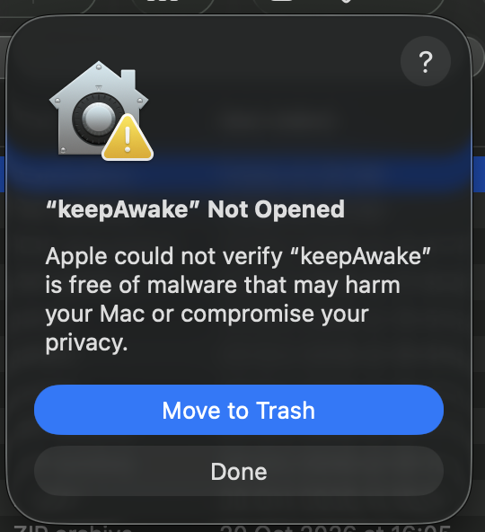
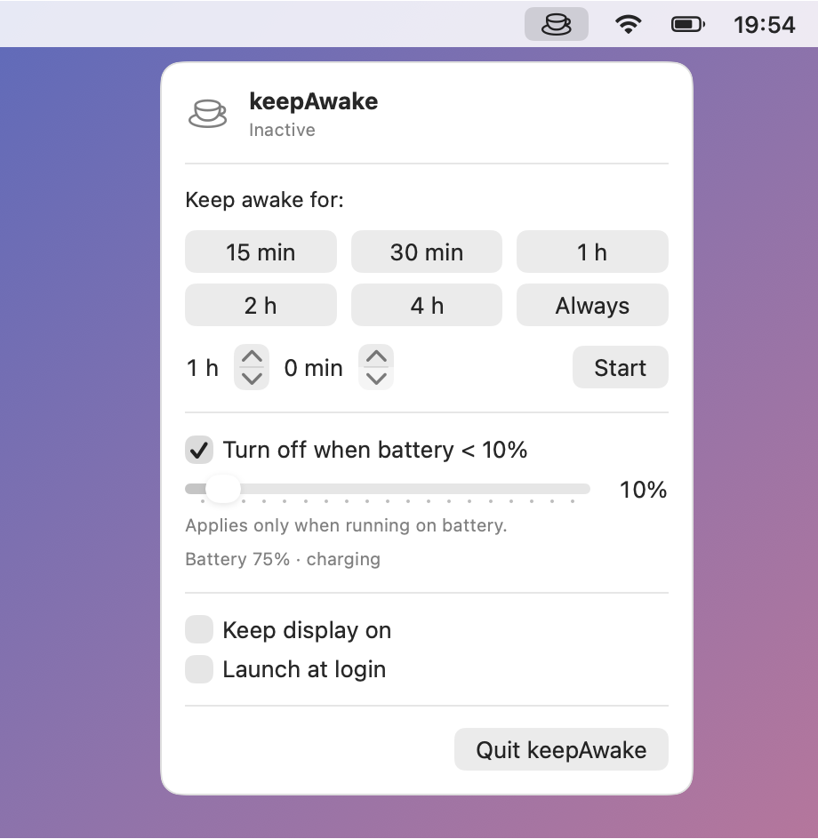
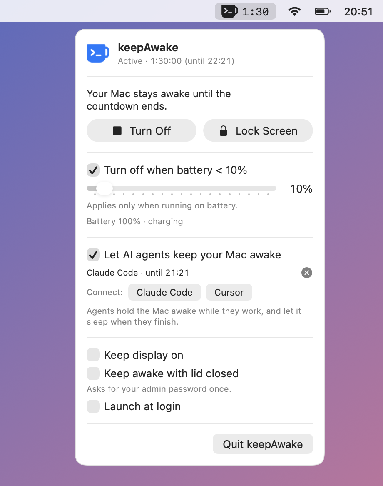
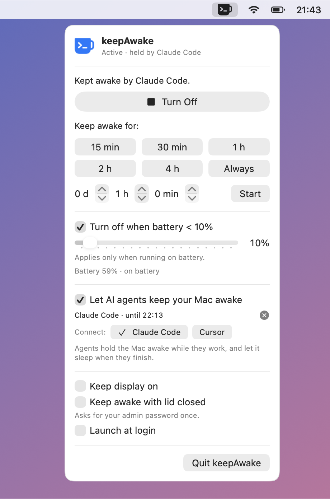

# keepAwake

A tiny macOS menu bar app that keeps your Mac from going to sleep — for a set time, forever, or until the battery runs low.

**[⬇ Download for Mac](https://github.com/mikespineu/keepAwake/releases/latest/download/keepAwake.zip)** (macOS 14+, Apple Silicon & Intel) · [Website with install guide](https://mikespineu.github.io/keepAwake/) · [What's new](CHANGELOG.md)

Unzip, drag `keepAwake.app` to Applications and open it. The first launch needs one permission step, see [First launch](#first-launch-allow-keepawake-in-privacy--security).

## First launch: allow keepAwake in Privacy & Security

keepAwake is from an independent developer and isn't notarized by Apple, so the first time you open a downloaded copy macOS blocks it. This is expected; you give it permission once.



1. Double-click keepAwake in Applications. macOS shows **“keepAwake” Not Opened**. Click **Done**, not *Move to Trash*.
2. Open **Apple menu → System Settings → Privacy & Security**.
3. Scroll down to **Security**. Next to *“keepAwake” was blocked to protect your Mac*, click **Open Anyway**.
4. Enter your password or use Touch ID.
5. macOS asks once more. Click **Open Anyway**. The mug appears in the menu bar.

**No “Open Anyway” button?** It only shows up for about an hour after macOS blocked the app. Open keepAwake again, click **Done**, and go back to Privacy & Security.

You don't need to change *“Allow applications from”* or disable any protection: **Open Anyway** allows only keepAwake. You'll repeat this after downloading an update.

Prefer Terminal? Instead of steps 1–5, remove the download quarantine flag, then open the app normally:

```bash
xattr -dr com.apple.quarantine /Applications/keepAwake.app
```

Apps you build yourself with `./build.sh` are not quarantined and open without this step.

<br clear="right">

<table>
  <tr>
    <td align="center"><b>Inactive</b></td>
    <td align="center"><b>Active (countdown in the menu bar)</b></td>
  </tr>
  <tr>
    <td>
      <picture>
        <source media="(prefers-color-scheme: dark)" srcset="docs/menu-inactive-dark.png">
        
      </picture>
    </td>
    <td>
      <picture>
        <source media="(prefers-color-scheme: dark)" srcset="docs/menu-active-dark.png">
        
      </picture>
    </td>
  </tr>
</table>

## Features

- **Pick a duration every time you turn it on:** 15 min, 30 min, 1 h, 2 h, 4 h, a custom days + hours + minutes value (up to 30 days), or **Always**.
- **Countdown in the menu bar** next to the mug icon.
- **Battery guard:** turns itself off when the battery drops below X% (on by default at 10%; only applies while running on battery).
- **Keep display on** (optional) — prevents the screen from dimming/sleeping too.
- **Keep awake with lid closed** (optional) — the Mac keeps running with the lid shut, even without an external display. Turning it on the first time asks for your admin password to install a one-line sudoers rule that only allows `pmset -a disablesleep 1` and `pmset -a disablesleep 0`.
- **Launch at login** (optional).
- **AI agents can keep the Mac awake while they work:** Claude Code, Cursor and any MCP client, connected with one click. See [Use with AI agents](#use-with-ai-agents).
- System notification when keepAwake stops by itself, and a sound when the time is up.
- No Dock icon, no background daemons. Root is used only by the optional lid-closed mode.

## Requirements

- macOS 14 Sonoma or newer
- Xcode **Command Line Tools** (full Xcode is not required)

Install the Command Line Tools if you don't have them yet:

```bash
xcode-select --install
```

Check that Swift 6.0 or newer is available:

```bash
swift --version
```

## Build and install

1. Clone the repository:

   ```bash
   git clone https://github.com/mikespineu/keepAwake.git
   cd keepAwake
   ```

2. Build the app bundle:

   ```bash
   ./build.sh
   ```

   This compiles a release build and creates `build/keepAwake.app` (ad-hoc signed, for your Mac's architecture).

3. Install it to `/Applications` and launch it:

   ```bash
   ./build.sh --install
   ```

   A cup icon appears in the menu bar. Click it to start.

To update later, `git pull` and run `./build.sh --install` again — it quits the running copy and replaces it.

### Quick run without installing

```bash
swift run
```

Notifications and *Launch at login* don't work in this mode because the binary isn't inside an app bundle.

## Usage

1. Click the cup icon in the menu bar.
2. Choose how long to stay awake — a preset, a custom time (then **Start**), or **Always**.
3. Optionally set the battery threshold with the slider.
4. Click **Turn Off** to stop early.

Verify that the sleep assertion is active:

```bash
pmset -g assertions | grep keepAwake
```

## Use with AI agents

Coding agents can keep your Mac awake while they work and let it sleep when they finish. Each agent gets its own **hold**: the menu lists who is holding the Mac awake, and the × next to a hold ends it. **Turn Off** ends every hold.

<picture>
  <source media="(prefers-color-scheme: dark)" srcset="docs/menu-agents-dark.png">
  
</picture>

### Connect Claude Code or Cursor

Click **Connect: Claude Code** or **Cursor** in the keepAwake menu. Or run it in Terminal:

```bash
/Applications/keepAwake.app/Contents/MacOS/KeepAwake install claude-code
```

```bash
/Applications/keepAwake.app/Contents/MacOS/KeepAwake install cursor
```

This adds two things, and leaves everything else in those files as it is. The first change to each file saves a copy next to it as `<file>.keepawake-backup`.

- **Hooks** (`~/.claude/settings.json`, `~/.cursor/hooks.json`): every prompt and tool call holds the Mac awake for the next 30 minutes. When the agent finishes its reply or the session ends, the hold ends. If the agent crashes, its hold ends within a second. The hooks read only the event name and the session id from the agent, never your prompts or tool input.
- **MCP server** (`claude mcp add --scope user keepawake`, `~/.cursor/mcp.json`): lets the agent ask for more time itself, e.g. "keep my Mac awake for 3 hours while the training runs". Tools: `keep_awake` (`minutes` 1–1440, default 60, optional `reason`), `allow_sleep`, `keep_awake_status`.

Start a new agent session after connecting. To undo, run the same command with `uninstall`. Other MCP clients can run `/Applications/keepAwake.app/Contents/MacOS/KeepAwake mcp` as a stdio server.

Turn off **Let AI agents keep your Mac awake** in the menu to ignore agents without uninstalling anything.

### Command line and URL scheme

The app binary is also a small CLI. It talks to the running app, and starts it if needed:

```bash
/Applications/keepAwake.app/Contents/MacOS/KeepAwake hold --id nightly --name "Nightly build" --minutes 120
```

| Command | URL | What it does |
|---|---|---|
| `hold --id ID [--name N] [--minutes 1-1440] [--pid P]` | `keepawake://hold?id=ID&name=N&minutes=M&pid=P` | Holds the Mac awake (30 min by default). Holding again with the same id renews it. With `pid`, the hold ends when that process exits. |
| `release --id ID` | `keepawake://release?id=ID` | Ends that hold. |
| `start [--minutes 1-43200]` | `keepawake://start?minutes=M` | Same as a preset in the menu; no minutes means Always. |
| `stop` | `keepawake://stop` | Same as Turn Off. |
| `status [--json]` | | Prints what keepAwake is doing. |

URLs work from anywhere that opens links, for example `open -g "keepawake://hold?id=backup&minutes=60"` or the *Open URLs* action in Shortcuts.

## How it works

| Piece | Implementation |
|---|---|
| Menu bar UI | SwiftUI `MenuBarExtra` (window style), `LSUIElement` app |
| Preventing sleep | IOKit `IOPMAssertionCreateWithName` (`PreventUserIdleSystemSleep` / `PreventUserIdleDisplaySleep`) — the same mechanism `caffeinate` uses |
| Battery level | IOKit `IOPSCopyPowerSourcesInfo` + power-source change notifications (no polling) |
| Settings | `UserDefaults` |
| Launch at login | `SMAppService.mainApp` |
| Lid closed | `sudo -n pmset -a disablesleep 1` / `0`, allowed by `/etc/sudoers.d/keepawake` (installed via `osascript … with administrator privileges`, checked with `visudo`) |
| Agent control | `keepawake://` URLs handled by `NSApplicationDelegate.application(_:open:)`; the app writes its state to `~/Library/Application Support/keepAwake/status.json`, which the CLI, hooks and MCP server read back |
| MCP server | The same binary run as `KeepAwake mcp`: JSON-RPC over stdio, no dependencies |

The assertion is released when you turn keepAwake off, when the timer or battery rule fires, or when the app quits, unless an agent hold is still keeping the Mac awake.

The lid-closed override is a system setting that outlives the app, so it is undone in every exit path: on stop and quit, by a small watchdog process if the app crashes or is force-quit (within ~5 seconds), and on the next launch after a reboot. If the lid is closed when keepAwake stops, it puts the Mac to sleep (`pmset sleepnow`). An override you set yourself with `pmset` is never touched.

Check whether the override is on (`SleepDisabled 1`) or off (`SleepDisabled 0`, or no line at all):

```bash
pmset -g | grep SleepDisabled
```

## Limitations

- A Mac kept awake with the lid closed in a bag can overheat. The battery guard still applies.
- `build.sh` builds only for the architecture of the Mac you build on. A universal (arm64 + x86_64) binary requires full Xcode.

## Uninstall

If you connected Claude Code or Cursor, remove the hooks and MCP server first:

```bash
/Applications/keepAwake.app/Contents/MacOS/KeepAwake uninstall claude-code
```

```bash
/Applications/keepAwake.app/Contents/MacOS/KeepAwake uninstall cursor
```

Quit keepAwake from its menu, then:

```bash
rm -rf /Applications/keepAwake.app
defaults delete com.michalkrecisz.keepAwake
rm -rf ~/Library/Application\ Support/keepAwake
```

If you used *Keep awake with lid closed*, also remove the sudoers rule:

```bash
sudo pmset -a disablesleep 0
```

```bash
sudo rm -f /etc/sudoers.d/keepawake
```

## Publishing a release

1. Bump `MARKETING_VERSION` (and `CURRENT_PROJECT_VERSION`) in `project.yml`.
2. Add a `## <version> — <date>` section to [CHANGELOG.md](CHANGELOG.md) and update *What's new* in `docs/index.html`. The release notes start with that changelog section; the script stops if it is missing.
3. Commit and push.
4. Run the release script:

   ```bash
   ./release.sh
   ```

The script builds a universal app (`./build.sh --universal`), packs it as `keepAwake.zip` and creates the GitHub Release `v<version>`. Use `./release.sh --dry-run` to only build the zip.

The website in `docs/index.html` is served by GitHub Pages from the `docs/` folder and always links to the latest release.

## Regenerating the screenshots and icon

The images in `docs/` (README) and `docs/appstore/` (App Store, 2880×1800) are rendered from the app's real SwiftUI views:

```bash
swift build -c release
BIN="$(swift build -c release --show-bin-path)"
cp Resources/Assets.xcassets/MenuBarIcon*.imageset/*.png "$BIN/"   # menu bar images
"$BIN/KeepAwake" --snapshot docs
```

The app icon is generated by `scripts/generate-icon.swift`:

```bash
swift scripts/generate-icon.swift
```

## Mac App Store

The project is prepared for the Mac App Store: App Sandbox, privacy manifest, icon, and an Xcode project (`keepAwake.xcodeproj`, generated from `project.yml` with [XcodeGen](https://github.com/yonaskolb/XcodeGen)). See [APPSTORE.md](APPSTORE.md) for the submission steps and listing metadata, and [PRIVACY.md](PRIVACY.md) for the privacy policy.

Builds from `build.sh` (and the release zip) are signed without the App Sandbox, because the lid-closed mode needs `sudo` and `osascript`. In the sandboxed store build that toggle is hidden.

## License

[MIT](LICENSE)
